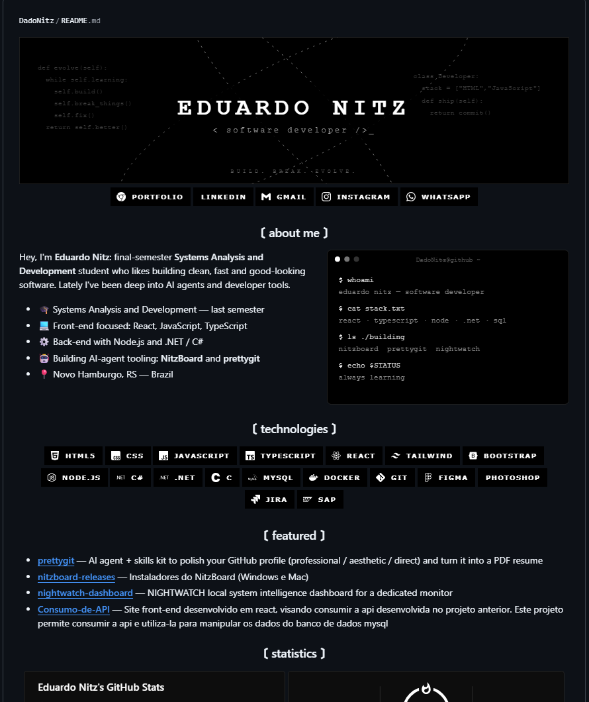

# prettygit

An AI agent and skills kit to improve your GitHub profile and turn it into a PDF resume. A dependency-free Node.js CLI fetches public data and generates drafts; the agent audits, interviews, and refines them. GitHub publication always requires explicit confirmation.

<p align="center"><br/><sub>A real profile built with <code>prettygit readme USER --style noir</code></sub></p>

<p align="center">   </p>

**Try it in the browser: https://prettygit-ruddy.vercel.app**, no install. Optional AI rewrite with your own Anthropic key, which never leaves your browser.

If prettygit made your profile better, a ⭐ helps other people find it.

## Quickstart

Requires Node 20+. PDF generation needs Chrome, Edge, or Chromium; set `CHROME_PATH` if it is not detected. Optional: authenticate with `gh auth login` or `GITHUB_TOKEN` for higher GitHub API limits. Never commit tokens.

Run from GitHub with npx (replace `USER` with your username):

```sh
npx --package=github:DadoNitz/prettygit prettygit resume USER --style aesthetic --lang en
```

Or clone and run locally:

```sh
git clone https://github.com/DadoNitz/prettygit.git
cd prettygit
node bin/prettygit.mjs fetch USER
node bin/prettygit.mjs readme out/USER/profile.json --style professional
node bin/prettygit.mjs resume USER --style aesthetic --lang en
npm test
```

No npm install is needed for the clone. If installed as a CLI, the command is `prettygit resume USER --style aesthetic`.

For experience and education, copy [the fictional example](examples/resume.example.json) to local `resume.json`, replace its values, and run:

```sh
node bin/prettygit.mjs resume out/USER/profile.json --extra resume.json --style professional --lang en
```

Commands: `fetch`, `readme`, `resume`, `styles`. Flags: `--style`, `--extra`, `--lang pt|en`, `--out DIR`. README/resume accept a username or saved profile JSON. Outputs go to `out/USER/`: `profile.json`, `README.STYLE.md`, and `resume-STYLE.html` / `.pdf`. Language defaults to Portuguese; `--lang` changes resume labels only. Personal `resume.json` and generated outputs are ignored by Git.

## Claude Code plugin

From the clone, load the local plugin:

```sh
claude --plugin-dir .
```

Ask Claude to use the `prettygit` agent to audit your profile, choose a style, interview you, and generate drafts. Individual skills: `/prettygit:profile-audit`, `/prettygit:profile-readme`, `/prettygit:resume-pdf`, `/prettygit:repo-polish`. The agent requests explicit confirmation of the final diff and target before publishing a README to `USER/USER`; career details stay local. See [Claude's plugin documentation](https://code.claude.com/docs/en/plugins/create).

Other agents can follow [AGENTS.md](AGENTS.md) and read the same skills directly.

## Styles

| Style | Direction |
|---|---|
| `professional` | Restrained, recruiter-focused, clear hierarchy |
| `aesthetic` | Personal, airy, visually curated |
| `direct` | Minimal, compact, facts first |

See [voice, emoji, and length guidance](styles/README.md). The agent refines template text; review the PDF's page count and layout before sharing.

## Polish bot

`bot/run.mjs` picks one repo from the allowlist in `bot/targets.json`, runs Claude Code headless with the [frontend-polish](skills/frontend-polish/SKILL.md) skill (Apple-style motion and feedback, tasteful visuals, `prefers-reduced-motion` safe) and opens **one draft PR**.

```sh
node bot/run.mjs                      # next repo in rotation
node bot/run.mjs owner/repo --dry-run # commit locally, no PR
node bot/run.mjs --discover           # suggest candidate repos; never opens PRs
```

It runs weekly via `.github/workflows/polish-bot.yml` (secrets: `CLAUDE_CODE_OAUTH_TOKEN` or `ANTHROPIC_API_KEY`, and `BOT_GH_TOKEN`). It only opens PRs on allowlisted repos, at most one open PR per repo, and the agent never receives the GitHub token. Only add a repo you own or whose maintainers welcome UI contributions: unsolicited bot PRs are spam.

## Layout

```text
.claude-plugin/   Claude Code manifest
agents/          Full profile-to-resume workflow
skills/          Audit, profile README, resume PDF, repo polish
bin/             CLI entry point
src/             GitHub fetching, PDF export, style renderers
styles/          Tone guide
examples/        Fictional resume data
test/            Node tests
docs/            Team ownership
.github/         CI, issue forms, PR template, CODEOWNERS
```

Join a [team](docs/TEAMS.md) and read [CONTRIBUTING](CONTRIBUTING.md). Licensed under [MIT](LICENSE).

## Em português

O prettygit melhora seu perfil do GitHub e gera currículo em PDF. Escolha `professional`, `aesthetic` ou `direct`; use `--lang pt` para os títulos do currículo. O agente entrevista você sem inventar experiências e só publica o README com confirmação explícita. Veja [como contribuir](CONTRIBUTING.md).
